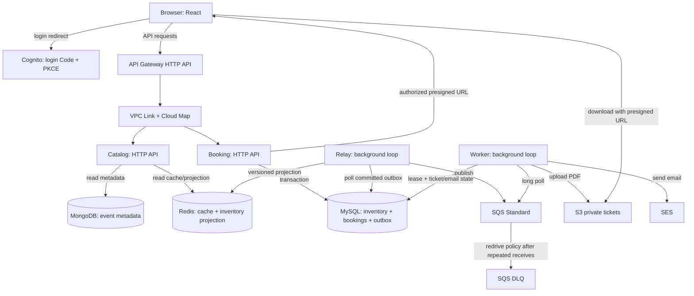

# 01 — Repository và cách tư duy về hệ thống

[Mục lục](README.md) · [Tiếp: Backend và dữ liệu](02-backend-and-data.md)

Chương này giúp bạn mở repository mà biết mình đang nhìn vào phần nào. Chưa cần khởi động AWS hay sửa code. Mở VS Code tại root `flash-ticket` và giữ chương này ở bên cạnh.

## 1. Bài toán mà ứng dụng thực sự xử lý

Flash-Ticket hiện thực một vòng đời nhỏ: xem sự kiện → đăng nhập → đặt một đến năm vé → chờ tạo PDF → tải vé → theo dõi trạng thái email. Chưa có payment, cancellation, hoàn vé hoặc hoàn tồn kho. Vì chưa có thanh toán, một booking được chấp nhận sẽ trừ tồn kho ngay và chuyển sang cấp vé.

Mục đích của việc giữ nghiệp vụ nhỏ là làm rõ các bài toán hạ tầng và độ tin cậy:

- Hai người cùng mua chiếc vé cuối thì ai được chấp nhận?
- HTTP response bị mất sau khi database đã commit thì retry có tạo đơn mới không?
- MySQL commit thành công nhưng SQS đang lỗi thì sự kiện có bị mất không?
- Worker chết giữa lúc tạo vé hoặc gửi email thì ai chạy tiếp?
- Bật lại dev sau khi dừng hoặc xóa thì tài nguyên, credentials và images được tìm lại ở đâu?

Mỗi câu hỏi tương ứng với một cơ chế trong source. Hãy đọc code theo câu hỏi này, thay vì cố hiểu mọi import ngay lần đầu.

## 2. Các khái niệm cần phân biệt trước

| Khái niệm | Trong dự án này | Điều dễ nhầm |
|---|---|---|
| Source code | Python, React, SQL, Terraform và scripts trong Git | Có source chưa có nghĩa database đã bootstrap |
| Docker image | Gói runtime được build từ Dockerfile và COPY source/dependencies | Image không phải process đang chạy |
| Container | Môi trường chạy image, có main process và có thể có process phụ | Dừng container không tự xóa database bên ngoài nó |
| ECS task definition | Phiên bản cấu hình image, CPU/RAM, env, IAM roles, logging | Đăng ký task definition chưa khởi động task |
| ECS task | Một lần chạy task definition | Task thay thế có thể có private IP khác |
| ECS service | Duy trì số task mong muốn và thực hiện rolling deployment | `desired_count=1` là một task tổng cộng, không phải một task mỗi AZ |
| ECS cluster | Nhóm quản lý services/tasks | Với Fargate, bạn không quản lý EC2 hosts của ECS |
| MongoDB EC2 | Máy ảo riêng dùng làm MongoDB data node | Khác Fargate application task |
| Terraform resource | Một đối tượng được provider tạo/quản lý | Chỉ tài nguyên thuộc state mới được destroy theo state đó |
| Terraform module | Nhóm resource tái sử dụng | Module không có state riêng nếu chỉ được gọi từ một root |
| Terraform root/state | Cấu hình được init/plan/apply và state lưu quan hệ resource ↔ AWS ID | Dự án có nhiều root; destroy một root không tự xóa mọi root khác |

Ba backend có MySQL access là Booking, Relay và Worker. Catalog dùng MongoDB + Redis. Bốn process này không phải bốn database riêng: chúng có trách nhiệm khác nhau nhưng MVP chia sẻ MySQL cho transaction/processing state. Khi mở rộng thành những domain services độc lập hơn, quyền sở hữu data và hợp đồng sự kiện cần được thiết kế tiếp.

Khi mở Python code, các thư viện sau có vai trò khác nhau:

| Công cụ/thư viện | Công việc trong dự án |
|---|---|
| FastAPI | Khai báo HTTP routes, dependencies và response models |
| Uvicorn | Process server nhận HTTP và chạy ứng dụng FastAPI; Relay/Worker không dùng nó |
| Pydantic v2 | Parse/validate request và cấu hình; request sai bị từ chối trước logic transaction |
| SQLAlchemy 2 | Tạo engine/pool, mở connection/transaction và thực thi SQL có parameters |
| PyMySQL | Driver kết nối MySQL bên dưới SQLAlchemy |
| PyMongo | Driver đọc/ghi MongoDB cho Catalog và bootstrap/seed |
| Redis client | Gửi command/Lua tới Redis; khác với chính Redis server |
| Boto3 | AWS SDK dùng gọi S3/SQS/SES; quyền gọi do credentials/IAM quyết định |

`lifespan()` trong FastAPI quản lý startup/shutdown, ví dụ khởi tạo và đóng client. Decorator `@app.post(...)` gắn một function vào route. Một `def` tên giống nhau trong service khác không tự trở thành cuộc gọi giữa hai service; giao tiếp chỉ xảy ra qua HTTP, database hoặc AWS SDK như code khai báo.

## 3. Toàn cảnh: ai gọi ai?



Mũi tên từ Relay tới MySQL có nghĩa **Relay chủ động hỏi database**, không phải database gửi HTTP request cho Relay. Tương tự Worker chủ động long poll SQS. Hai process nền bắt đầu hoạt động khi task/container của chúng chạy, kể cả lúc browser không mở.

Sơ đồ này trình bày quan hệ ứng dụng. Sơ đồ hai AZ và vị trí subnets nằm ở [chương Terraform](04-terraform-and-aws.md). CloudFront phân phối frontend và banners; nó không nằm trong transaction đặt vé.

## 4. Dữ liệu nào là nguồn quyết định?

| Nơi lưu | Nội dung | Độ tin cậy/độ trễ cần hiểu |
|---|---|---|
| MongoDB | Tên, mô tả, banner key và trạng thái publish của sự kiện | Metadata catalog, không quyết định có được bán vé hay không |
| MySQL `inventory` | `total`, `remaining`, `version` theo event UUID | Nguồn quyết định tồn kho khi nhận booking |
| MySQL `bookings` | Chủ sở hữu, email, số lượng, idempotency, ticket/email state và lease | Nguồn quyết định trạng thái đơn |
| MySQL `outbox` | Payload sự kiện đã commit, retry/lease và `published_at` | Cầu nối bền vững từ transaction đến SQS |
| Redis | Metadata cache và inventory projection theo version | Có thể chậm hơn MySQL; không dùng để chấp nhận bán vé |
| SQS | Công việc đang chờ xử lý hoặc sẽ được giao lại | Standard có thể giao trùng hoặc khác thứ tự |
| S3 assets | Banners và PDF tickets | Object storage; trạng thái nghiệp vụ vẫn do database quyết định |
| SSM SecureString | Secrets/cấu hình nhạy cảm, ECS nạp vào task environment lúc khởi động qua Execution Role | Không phải nơi lưu booking hay Terraform state |
| Terraform state | Địa chỉ resource, AWS IDs và các thuộc tính provider lưu | Không phải backup dữ liệu MySQL/MongoDB |

Ví dụ: UI hiển thị còn `1` vé từ Redis, trong khi người khác vừa mua xong và MySQL còn `0`. Booking mới phải trả `409`; đây là hành vi đúng của read projection có độ trễ. Không chữa bằng cách bỏ điều kiện kiểm tra trong SQL.

`version` tăng trong cùng transaction với trừ tồn kho. Relay có thể publish các events khác thứ tự; Redis chỉ nhận version mới hơn để một bản tin cũ không làm số vé tăng trở lại. Cơ chế này không tự đồng bộ MongoDB với MySQL khi thêm một sự kiện mới.

## 5. Mở repository: trách nhiệm từng nhóm file

```text
flash-ticket/
  frontend/                     Browser UI và Nginx image
  services/
    booking/app/main.py         HTTP API đặt vé và tải vé
    catalog/app/main.py         HTTP API danh sách/tạo event DRAFT
    relay/app/main.py           Poll outbox, Redis projection, SQS publish
    worker/app/main.py          SQS consume, lease, PDF/S3/SES
    worker/app/ticket.py        Tạo PDF và QR
  shared/                       Auth, database, AWS clients, Redis projection
  database/                     SQL migrations và transaction smoke script
  tools/mysql-bootstrap/        One-off image tạo schema/users an toàn
  scripts/                      Local setup, AWS deployment và recovery
  infra/
    bootstrap/                  Terraform root tạo state bucket
    environments/dev-foundation/ Terraform root foundation
    environments/dev/           Terraform root runtime/data
    modules/                    Các module được roots gọi
  tests/                        Các kiểm tra offline
  docs/                         Runbooks và bộ onboarding này
  compose.yaml                  MySQL, MongoDB, Redis và LocalStack
  compose.override.yaml         Bốn app services và frontend cho local
  .env.example                  Mẫu cấu hình local, không chứa secrets thật
  README.md                     Lối vào tài liệu
```

### 5.1 Frontend: bắt đầu ở đâu?

Đọc [frontend/src/main.jsx](../../frontend/src/main.jsx) để thấy React mount vào HTML, rồi mở [App.jsx](../../frontend/src/App.jsx) để tìm form và handlers. Phần HTTP được gom trong [api.js](../../frontend/src/api.js); authentication/token lifecycle nằm ở [auth.js](../../frontend/src/auth.js).

[vite.config.js](../../frontend/vite.config.js) phục vụ build/dev. [nginx.conf](../../frontend/nginx.conf) phục vụ static build trong container local và proxy `/api`. AWS frontend được upload lên S3/CloudFront bằng stage `frontend`; không chạy Nginx frontend task trên ECS.

### 5.2 Backend: mỗi service có entry point riêng

| File | Entry point nên tìm | Câu hỏi khi đọc |
|---|---|---|
| [Booking main.py](../../services/booking/app/main.py) | `create_booking`, `get_booking`, `get_ticket` | Ai được mua/xem vé? Commit ở đâu? Retry thế nào? |
| [Catalog main.py](../../services/catalog/app/main.py) | `load_metadata`, `get_events`, `create_event` | Đọc cache lúc nào? Metadata và inventory ghép thế nào? |
| [Relay main.py](../../services/relay/app/main.py) | `main`, `claim_event`, `publish`, `mark_published` | Làm sao nhiều relay không cùng giữ một lease? |
| [Worker main.py](../../services/worker/app/main.py) | `main`, `process_message`, `claim_booking`, `Heartbeat` | Khi nào xóa SQS message? Khi nào gửi email lại? |

FastAPI route handlers ở Booking/Catalog nhận HTTP. Relay/Worker là vòng lặp Python, không khởi chạy Uvicorn và không cần mở port HTTP. Các `__init__.py` rỗng giúp xác định Python packages; đừng xóa chỉ vì không thấy logic bên trong.

### 5.3 Shared: code dùng chung, cần review phạm vi rộng

| File | Trách nhiệm | Sửa file này có thể ảnh hưởng |
|---|---|---|
| [auth.py](../../shared/auth.py) | `AUTH_PROVIDER`, Cognito JWKS/custom JWT, Principal và scopes | Booking, Catalog |
| [database.py](../../shared/database.py) | SQLAlchemy engine, TLS, isolation level, pool/timeouts | Booking, Relay, Worker |
| [aws.py](../../shared/aws.py) | Boto3 client config, local endpoint | Các process gọi AWS/LocalStack |
| [inventory.py](../../shared/inventory.py) | Redis client và Lua versioned projection | Relay, Catalog và scripts liên quan |
| [errors.py](../../shared/errors.py) | Chọn thông tin lỗi an toàn để log | Backend và tooling sử dụng helper |

Không sửa `shared` như thể chỉ có một người gọi. Ví dụ đổi database pool size có thể tăng tổng connections của ba ECS services và nhân tiếp khi rolling deploy có old/new tasks cùng chạy.

### 5.4 Database và bootstrap

[database/001_schema.sql](../../database/001_schema.sql) tạo `inventory`, `bookings`, `outbox` và demo inventory. [tools/mysql-bootstrap/bootstrap.py](../../tools/mysql-bootstrap/bootstrap.py) thực thi migrations theo thứ tự, kiểm tra checksum ledger, tạo/cập nhật application users và hỗ trợ kiểm tra file trong image.

Không sửa `001_schema.sql` sau khi đã áp dụng. Một thay đổi schema mới cần migration file mới. Terraform tạo RDS instance không tự tạo các application tables; bootstrap là bước riêng. Chi tiết về DDL, checksum và quyền database ở [chương 2](02-backend-and-data.md) và [MySQL runbook](../mysql-bootstrap.md).

MongoDB có bước tạo users riêng qua [provision_mongodb.py](../../scripts/provision_mongodb.py) và script Mongo shell [bootstrap.js](../../scripts/mongodb/bootstrap.js). AWS seed catalog và local seed khác entry point vì môi trường truy cập khác nhau.

### 5.5 Scripts: nhóm local và nhóm AWS

| Nhóm | File tiêu biểu | Dùng để làm gì |
|---|---|---|
| LocalStack/local app | `init_queue.py`, `init_assets.py`, `seed_catalog.py`, `local_token.py` | Tạo tài nguyên giả lập, demo event và token local |
| Kiểm tra inventory | `reconcile_inventory.py` | Đồng bộ lại projection bằng trạng thái MySQL; đọc hướng dẫn trước khi chạy |
| Deployment stages | `deploy_dev.py` | Điều phối prepare/bake/data/images/bootstrap/start/frontend/status/stop/destroy |
| Bật/tắt tiện dụng | `aws-dev-up.sh`, `aws-dev-down.sh`, `aws_dev_power.py` | Chọn và gọi stages dựa trạng thái thực tế |
| Secrets và Terraform wrapper | `aws_dev_secrets.py`, `tf-dev.sh` | Quản lý secrets local/SSM và cung cấp runtime Terraform inputs |
| MongoDB lifecycle | `bake_mongo_ami.py`, `ssh-mongodb.sh`, `repair_mongodb_bootstrap.py` | Build AMI, truy cập private node và sửa lỗi bootstrap có kiểm soát |
| Integration checks | `test_mysql_bootstrap_integration.py`, `test_mongodb_bootstrap.py` | Kiểm chứng bootstrap trong môi trường được runbook mô tả |

Scripts local không thừa chỉ vì AWS đã chạy. Chúng cho phép phát triển/kiểm tra luồng ứng dụng mà không tiêu AWS credit. Không dùng `init_queue.py` thay Terraform để tạo AWS production queue.

### 5.6 Terraform: đọc root trước, module sau

Khi học một resource, đi từ `infra/environments/.../main.tf` hoặc `deployment.tf` tới `module` được gọi, rồi đọc `variables.tf`, resource file và `outputs.tf` của module đó. Cách này giúp biết giá trị thực tế được truyền từ đâu.

Ví dụ: thấy RDS trong `infra/modules/data_layer/rds.tf` chưa đủ để biết dev có tạo RDS hay không. Phải kiểm tra flags ở root runtime và inputs truyền vào module. Các cờ được deployment scripts lưu/đọc; sửa một giá trị trong module có thể chưa thay đổi cấu hình đang apply.

Đừng xem ba roots như ba bản sao của cùng hạ tầng. Chúng có vòng đời khác nhau: backend bucket để lưu state; foundation chứa nền tảng/tài nguyên được giữ lại qua reset runtime; runtime chứa data/application deployment. [Chương 4](04-terraform-and-aws.md) chỉ rõ danh mục và thứ tự phụ thuộc.

## 6. Lần theo một booking trong source

Thực hiện bằng chức năng tìm kiếm toàn workspace của VS Code (`Ctrl+Shift+F`); không cần cài thêm công cụ CLI.

1. Tìm `Idempotency-Key` để nối frontend API helper với Booking header dependency.
2. Trong `create_booking()`, tìm `engine.begin()`. Đánh dấu vị trí `UPDATE inventory`, `INSERT INTO bookings`, `INSERT INTO outbox`.
3. Tìm `BookingCreated` để nối event_type giữa outbox và consumer.
4. Mở `claim_event()` của Relay, quan sát điều kiện `published_at`/lease và `SKIP LOCKED`.
5. Trong `publish()`, xác định thứ tự projection Redis → SQS publish → đánh dấu outbox.
6. Trong Worker, tìm `process_message()` và `delete_message` để thấy thời điểm acknowledgement.
7. Quay lại Booking `get_ticket()` để thấy người dùng không được tự chọn S3 key tùy ý.

Sau đó tự kể lại chuyện gì xảy ra nếu process chết sau từng bước. Đây là cách hiểu retry/idempotency tốt hơn việc chỉ đọc tên pattern.

## 7. Auth và email: hai danh tính khác nhau

`user_id` trong MySQL là subject lấy từ access token đã được xác thực. Email nhận PDF là dữ liệu của booking form. Hai giá trị không bắt buộc trùng nhau. Đổi email form không đổi người sở hữu booking; đăng nhập tài khoản khác không được đọc booking của tài khoản trước.

AWS Cognito xác minh danh tính cho login. AWS SES xác minh sender/recipient hoặc domain để gửi thư, tùy sandbox/production access. Người dùng login Cognito thành công không tự làm recipient được SES xác minh. Khi app còn ở SES sandbox, thử email khác phải kiểm tra identity trong **cùng region** với Worker.

API Gateway JWT authorizer đứng trước các booking routes; FastAPI vẫn kiểm tra token ở backend. Local dùng custom JWT adapter vì không cần Cognito để thực hành. Đây là hai cấu hình thay thế cho cùng contract xác thực, không phải tin mọi token chỉ vì request đã đi qua Gateway.

## 8. Dev hai AZ có nghĩa chính xác là gì?

VPC có public, private-app và private-data subnets trải trên AZ A/B. VPC Link có ENIs trong private-app subnets. Ở dev, mỗi ECS service chỉ có một task, thường dùng Fargate Spot và public IP để đi ra Internet qua Internet Gateway khi không có NAT Gateway.

Task có public IP không có nghĩa API được mở công khai ở port 8000: SG chỉ chấp nhận ingress từ VPC Link SG cho Booking/Catalog; Worker/Relay không có inbound application port. API Gateway vẫn gọi private IP thông qua Cloud Map.

RDS/Redis dev có một primary; MongoDB là một EC2 standalone ở private data subnet. Có subnet ở AZ B không tạo thêm standby/replica. Phải phân biệt **network đã sẵn cấu trúc hai AZ** với **workload đã chạy HA ở hai AZ**.

## 9. Khi cần sửa một tính năng, mở file nào?

| Yêu cầu hoặc triệu chứng | Bắt đầu ở đâu | Đọc tiếp |
|---|---|---|
| Đổi form/email/trạng thái UI | `frontend/src/App.jsx` | `api.js`, Booking response model |
| Đổi token/login behavior | `frontend/src/auth.js` | `shared/auth.py`, foundation Cognito config |
| Chống request gửi lại tạo thêm booking | Booking `create_booking()` | Unique key, request hash, API helper |
| Vé trên UI chậm cập nhật | Catalog `get_events()` | Redis projection, Relay, MySQL inventory version |
| Có booking nhưng chưa có PDF | Worker `process_message()` | Outbox, SQS/DLQ, lease và CloudWatch logs |
| PDF có nhưng email đang xử lý | Worker nhánh SES | Stored recipient, SES status/sandbox, logs, queue/DLQ |
| Task không khởi động | `infra/modules/ecs_runtime` | Execution Role, SSM, image URI/tag, ECS events |
| Up tạo lại resource ngoài dự tính | `aws_dev_power.py`, `deploy_dev.py` | Ba states, flags và Terraform plan |
| MongoDB sau reboot không sẵn sàng | MongoDB node/bootstrap scripts | Cloud-init output, mongod, repair runbook |
| Muốn giảm chi phí khi nghỉ | `aws-dev-down.sh` | Phạm vi `stop`/`runtime`/`all`, [chương 5](05-docker-and-operations.md) |

## 10. Những file không nằm trong Git nhưng vẫn phải giữ

- `.env`, `.secrets/`: local configuration, JWT keys và bản secrets hỗ trợ phục hồi môi trường dev.
- Terraform state/backup của bootstrap: quan hệ với state bucket; Git clone không tái tạo được state đã mất.
- `backend.hcl`, tfvars và deployment metadata bị ignore: cấu hình môi trường riêng, không phải mọi clone đều có sẵn.
- Database volumes local, dữ liệu RDS/MongoDB, S3 tickets: dữ liệu runtime không nằm trong source repository.

Lockfiles (`package-lock.json`, Terraform `.terraform.lock.hcl`, Python requirements đã pin/hash ở tool liên quan) cần giữ trong Git để tái lập dependencies. `.gitignore` không phải backup và cũng không xóa secret đã từng bị commit.

## 11. Bài tập trước khi sang backend

Không chạy lệnh tạo/xóa AWS. Mở code và viết câu trả lời của bạn vào một ghi chú cá nhân:

1. Với một booking, table nào thay đổi trước khi API trả `202`? Redis có nằm trong transaction đó không?
2. Khi Relay bị dừng 10 phút, booking đã commit có còn không? Thành phần nào cần hoạt động để PDF được tạo?
3. Khi UI hiển thị hết vé khác với MySQL, nơi nào quyết định chấp nhận request?
4. `desired_count=1` đặt trong VPC hai AZ tạo mấy task cho mỗi service?
5. Ai cấp URL tải PDF và ai kiểm tra người tải là chủ booking?
6. Nếu chỉ có Git source mà mất state và local secrets, bạn có thể dùng `destroy` như cũ ngay không? Cần điều tra quan hệ state/resource trước.

Đáp án đúng phải viện dẫn được file/function. Khi làm được, bạn đã có bản đồ để học sâu hơn thay vì đọc code theo cảm giác.

[Tiếp tục chương 2 — Backend và dữ liệu](02-backend-and-data.md).
